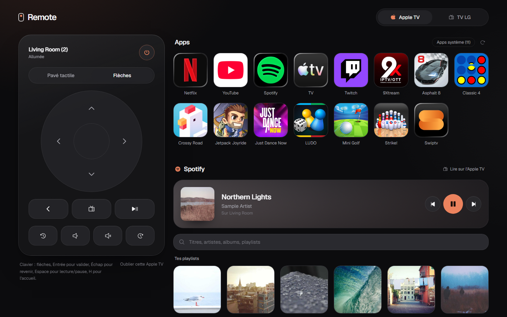
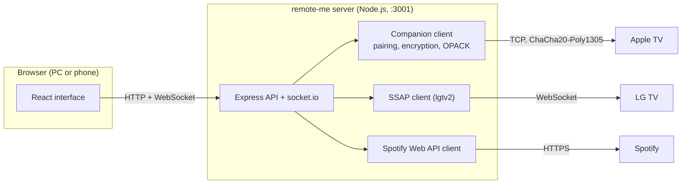
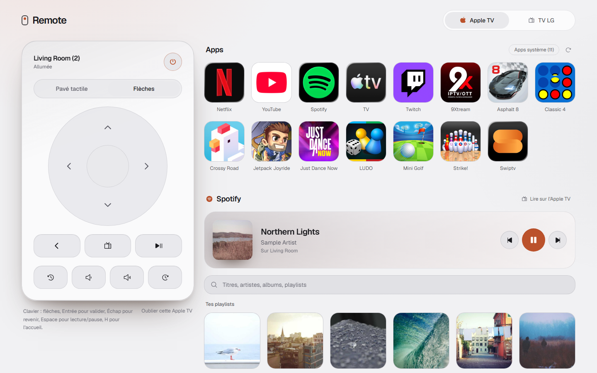
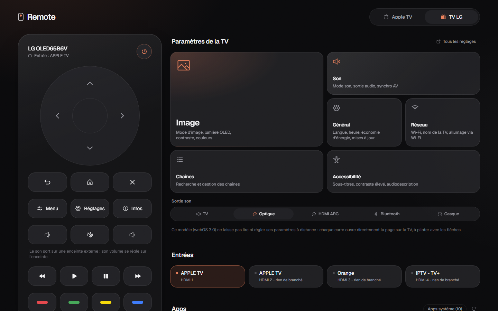
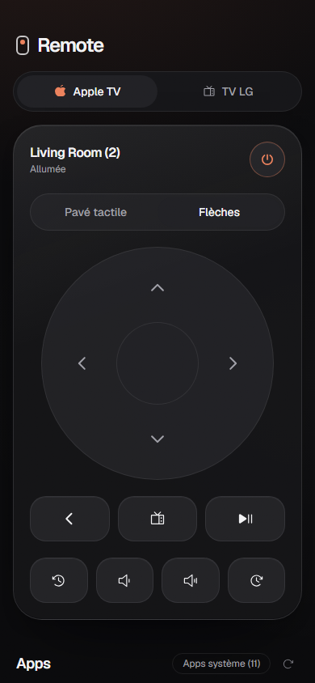
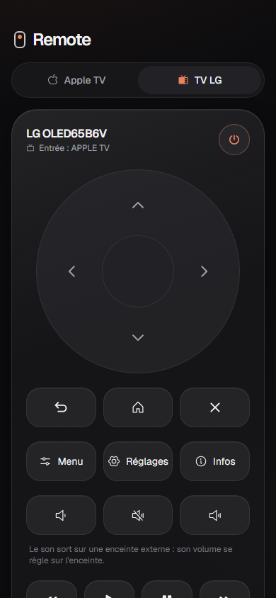

# remote-me

**A web remote for Apple TV and LG TVs, built by reverse-engineering Apple's own remote.**

[](#roadmap)
[](https://nodejs.org)
[](https://react.dev)
[](docs/reverse-engineering.md)
[](LICENSE)

> 🇫🇷 **En bref** : télécommande web pour Apple TV et TV LG, utilisable depuis un PC ou un téléphone. Côté Apple,
> le protocole a été retrouvé en analysant la télécommande intégrée à iOS (REA + Ghidra, avec un agent IA) puis
> vérifié sur l'appareil. Mon premier projet de reverse engineering appliqué à la domotique. Projet en cours.



remote-me runs on a computer at home and serves a remote control page to any browser on the network: the desktop
it runs on, a laptop, or a phone added to its home screen. It drives an **Apple TV** over the same Companion
protocol as the remote in iOS Control Center, an **LG webOS TV** over SSAP, and **Spotify** through its Web API.

This is my first reverse-engineering project applied to home automation, done with an AI coding agent
(Claude Code) running the analysis tools. It works daily on my setup, but it is still a work in progress.

## Contents

- [Quick start](#quick-start)
- [Everyday use](#everyday-use)
- [What it controls](#what-it-controls)
- [How it works](#how-it-works)
- [Reverse-engineering highlights](#reverse-engineering-highlights)
- [Screenshots](#screenshots)
- [FAQ](#faq)
- [Documentation](#documentation)
- [Roadmap](#roadmap)
- [Disclaimer](#disclaimer)
- [License](#license)

## Quick start

Requirements: Node.js 20 or later, and the computer on the same network as the TVs.

```bash
git clone https://github.com/jxgedouard/remote-me.git
cd remote-me
npm install      # installs the backend and the interface
npm start        # builds the interface on first run, then serves everything on port 3001
```

Open <http://localhost:3001>, then pair once:

1. **Apple TV**: pick it in the list (or type its IP) and enter the 4-digit code shown on the TV.
2. **LG TV**: type its IP and accept the prompt on the TV.
3. **Spotify** (optional, needs Premium): create an app on the
   [Spotify developer dashboard](https://developer.spotify.com/dashboard), add the redirect URI shown in the
   panel, paste the Client ID, then log in from the computer running remote-me.

Pairing keys and tokens are stored in `backend/data/`, which is git-ignored.

## Everyday use

| I want to... | Do this |
|---|---|
| Use it on the computer | `npm start`, then <http://localhost:3001> |
| Use it on my phone | Open `http://<computer-ip>:3001` and "Add to Home Screen" |
| Change the port | `PORT=4000 npm start` (PowerShell: `$env:PORT=4000; npm start`) |
| Hack on it with hot reload | `npm run dev`: backend on :3001, interface on <http://localhost:5173> |
| Move it to another computer | Clone, `npm install`, `npm start`, and either pair again or copy the old `backend/data/` folder |

Keyboard shortcuts on a computer: arrows, Enter to select, Esc to go back, Space for play/pause, H for home
(plus M for the quick menu and I for info on the LG page).

## What it controls

| Device | Features | Protocol |
|---|---|---|
| Apple TV (tvOS, tested on Apple TV 4K 3rd gen) | Touchpad (raw touch events) or D-pad, Select / Back / TV / Play, volume, skip ±10 s, power, app list with App Store icons (system apps hidden), launch apps, type into text fields from the computer keyboard | Companion link (`_companion-link._tcp`), TVRemoteCore session |
| LG webOS TV (tested on webOS 3.0) | D-pad, Back / Home / Exit, quick menu, colors, media keys, volume slider, sound output, HDMI inputs with their labels, apps, direct links to six settings sections, text input, power off / Wake-on-LAN | SSAP over WebSocket |
| Spotify | Now playing, previous / play-pause / next, search (tracks, artists, albums, playlists), your playlists, play on the Apple TV | Spotify Web API (PKCE, no client secret) |

## How it works



- `backend/companion/`: a from-scratch Companion client. HAP pairing (SRP-6a, Ed25519, X25519), encrypted
  frames, OPACK encoding, HID buttons and touch, apps, and the RTI remote keyboard.
- `backend/services/`: device services (Apple TV, LG, Spotify, App Store icon lookup), each pushing live state
  to the interface over socket.io.
- `frontend/`: React 19, Vite, Tailwind, Motion and Phosphor icons. On a computer the remote stays pinned on
  the left and the content uses the rest of the screen; on a phone everything stacks. Dark and light themes
  follow the system setting.

## Reverse-engineering highlights

The full notes are in [docs/apple-remote-protocol.md](docs/apple-remote-protocol.md) and the method in
[docs/reverse-engineering.md](docs/reverse-engineering.md).

- **Wrong protocol, found in one search.** The library first used spoke MRP. Class names in iOS's
  `TVRemoteCore` showed the native remote goes through Rapport's Companion link instead.
- **The missing handshake.** Requests were acknowledged but ignored until
  `TVRCSessionStart {ProtocolVersionKey: "1.2"}`, found in a decompiled session-start method, was sent first.
- **Arrows dropped during touch.** Not in any binary: the Apple TV ignores arrow commands while a touch
  session is open. Found with labelled live tests in front of the TV, fixed by closing the touch session before
  an arrow press.
- **Typing from the PC.** The RTI keyboard payloads (`NSKeyedArchiver` plists) let the computer keyboard
  type straight into tvOS search fields such as Spotify's.
- **Knowing when to stop.** The LG firmware is encrypted, and its API refuses to read settings, so the LG page
  opens the right settings section instead of pretending to edit values. See [docs/lg-webos.md](docs/lg-webos.md).

## Screenshots

| Apple TV, light theme | LG TV |
|---|---|
|  |  |

| Phone, Apple TV | Phone, LG TV |
|---|---|
|  |  |

Spotify content in the screenshots is sample data.

## FAQ

**Does it need the cloud or an Apple account?**
No. Apple TV and LG control stay on the local network. Only Spotify and the App Store icon lookup go online.

**Which Apple TV models work?**
Tested on an Apple TV 4K (3rd generation) with current tvOS. Other tvOS 15+ models that advertise
`_companion-link._tcp` should work but are untested.

**Can it change the volume of speakers connected by optical cable?**
Not by itself: optical carries no control. A Wi-Fi infrared blaster or a small serial bridge (for some
speaker systems) would be needed.

**Is the interface in French?**
Yes, for now. The code and docs are in English.

## Documentation

| Document | Content |
|---|---|
| [docs/apple-remote-protocol.md](docs/apple-remote-protocol.md) | Companion transport, TVRemoteCore requests, HID table, touch, keyboard, with binary addresses |
| [docs/reverse-engineering.md](docs/reverse-engineering.md) | Toolchain and method (IPSW, `ipsw`, REA, Ghidra, live verification), and how to redo it on a new iOS |
| [docs/lg-webos.md](docs/lg-webos.md) | What the LG SSAP API allows on webOS 3.0 and what it refuses |

## Roadmap

- [ ] Volume for external speakers (infrared blaster)
- [ ] English interface
- [ ] Now-playing info from the Apple TV itself (`NowPlayingInfo` events are received but not decoded yet)
- [ ] Settings values on newer LG webOS versions
- [ ] Tests for the Companion client

## Disclaimer

remote-me is a personal project, not affiliated with or endorsed by Apple, LG or Spotify. The Apple TV protocol
was studied from Apple's publicly distributed iOS firmware, for interoperability with devices I own, and is
used only on my local network. Use it with your own devices and at your own risk.

## Credits

[REA](https://github.com/morluto/rea) and [Ghidra](https://ghidra-sre.org) for the analysis,
[`ipsw`](https://github.com/blacktop/ipsw) for the firmware extraction,
[pyatv](https://github.com/postlund/pyatv) for prior public work on the Companion protocol,
[`lgtv2`](https://github.com/hobbyquaker/lgtv2) for SSAP, and Claude Code as the agent driving all of it.

## License

[MIT](LICENSE)
